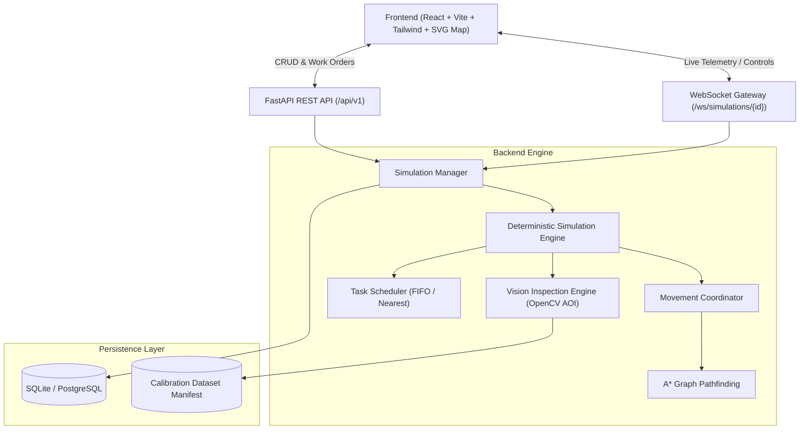

# FactoryTwin — System Architecture & Digital Twin Design

## 1. High-Level System Overview

FactoryTwin is a multi-agent digital twin simulation and automated optical inspection platform designed for smart manufacturing facilities. The platform orchestrates autonomous mobile robots (AGVs), schedules production work orders, executes collision-safe pathfinding, handles dynamic blockages, and performs real computer-vision-based quality inspection.

## 2. Component Breakdown

### A. Frontend Layer (`frontend/`)
- **React 19 + TypeScript**: Strict type safety throughout models and hooks.
- **Factory Floor SVG Canvas**: Real-time rendering of 20x15 grid cells, designated workstations, warehouse racking, charging pads, AGVs, planned path lines, and dynamic obstacles.
- **Real-time WebSocket Hook (`useSimulationSocket`)**: Bi-directional communication with auto-reconnection, exponential backoff, and REST fallback polling.
- **AI Vision Workstation**: Upload custom component images or select calibrated industrial specimens, visualize side-by-side defect localization heatmaps, and inspect confusion matrix metrics.
- **Benchmark Dashboard**: Interactive Recharts bar/line comparisons between FIFO and Nearest Available Robot scheduling.

### B. Simulation Core (`backend/app/simulation/`)
- **Deterministic Simulation Clock**: Discrete time steps (`tick: int`). No wall-clock sleeps in core physics/logic.
- **Robot State Machine**: Explicit legal transitions (`IDLE` -> `ASSIGNED` -> `MOVING` -> `WAITING` -> `INSPECTING` -> `COMPLETED` -> `FAULTED`).
- **A* Pathfinding**: Pure Python implementation using Manhattan distance heuristic:
  $$h(n) = |x_n - x_{goal}| + |y_n - y_{goal}|$$
  Deterministic priority queue with tie-breaking, obstacle avoidance, and dynamic forbidden coordinate sets.
- **Movement Coordinator**: Centralized safety coordinator enforcing zero simultaneous vertex occupancy and zero head-on edge swaps.
- **Pluggable Schedulers**: Pluggable interface supporting FIFO and Nearest Available Robot (A* topological distance).

### C. Automated Optical Inspection (AOI) (`backend/app/inspection/`)
- **Golden CAD Template Differential Analysis**: Compares inspected mechanical flanges against nominal baseline CAD representations.
- **Contour Segmentation & Morphological Filtering**: Detects fissures, cracks, voids, and perimeter chips.
- **Calibrated Scoring**: Outputs genuine anomaly scores $\in [0.0, 1.0]$, confidence ratings, and bounding-box annotated localization images.

### D. Persistence (`backend/app/db/`)
- **SQLAlchemy 2.0 ORM**: Structured tables for `SimulationScenarioRecord`, `SimulationRunRecord`, `TaskRecord`, `InspectionRecord`, and `BenchmarkRecord`.
